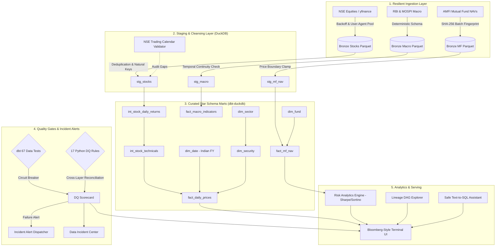

# 🇮🇳 India Finance Intelligence Terminal

[-success.svg)](#architecture)

An institutional-grade, local-first **Medallion Lakehouse** and **Financial Intelligence Terminal** built for Indian capital markets (NSE equities, benchmark indices, AMFI mutual funds, and RBI/MOSPI macroeconomic indicators).

Engineered with a **Bloomberg Terminal-inspired UX** and a **QA-first paradigm**: automated circuit breakers, idempotency fingerprints, cross-layer reconciliation, interactive data lineage DAG, incident blast-radius tracking, and a guardrailed local AI analytical assistant with safe text-to-SQL.

---

## 📚 Technical Documentation, Presentation & Interview Resources

All architecture blueprints, forensics, question banks, and presentation decks are available inside the `docs/` directory:

| Deliverable / Guide | Format | Description & Scope |
| :--- | :---: | :--- |
| **[Master Technical Handbook](docs/PROJECT_TECHNICAL_HANDBOOK.md)** | `Markdown` / **[PDF](docs/PROJECT_TECHNICAL_HANDBOOK.pdf)** | 19-chapter comprehensive technical handbook covering full architecture, formulas, and walkthroughs. |
| **[Interactive Presentation Deck](docs/India_Finance_Intelligence_Presentation.html)** | `HTML` / **[PPTX](docs/India_Finance_Intelligence_Presentation.pptx)** | 30-slide animated presentation deck with Bloomberg UI styling, live charts, and embedded speaker notes. |
| **[System Architecture Blueprints](docs/PROJECT_ARCHITECTURE.md)** | `Markdown` | 9 high-resolution Mermaid blueprints (End-to-End, Medallion, dbt DAG, Quality Gate, ERD). |
| **[Repository File Inventory](docs/PROJECT_FILE_INVENTORY.md)** | `Markdown` | Complete forensic audit of every module, class, function, read/write path, and dependency. |
| **[Implementation Evidence Matrix](docs/IMPLEMENTATION_EVIDENCE.md)** | `Markdown` | Verification matrix validating every claim against active source code and test outputs. |
| **[Interview Question Bank (100+ Qs)](docs/INTERVIEW_QUESTION_BANK.md)** | `Markdown` | 100 deep-dive questions across 10 categories + advanced SQL interview exercises. |
| **[Interview Quick Revision](docs/INTERVIEW_QUICK_REVISION.md)** | `Markdown` | 1-page rapid revision cheat sheet (formulas, commands, top 25 Q&As, common traps). |
| **[Presentation Speaker Notes](docs/PRESENTATION_SPEAKER_NOTES.md)** | `Markdown` | 30-slide first-person spoken scripts, visual cues, and follow-up defenses. |

---

## 🖥️ 11 Institutional Financial Terminal Workspaces

The terminal provides 11 dedicated workspaces in a persistent dark interface (`#080C12`, `#111A26`):

1. **Market Overview**: Real-time snapshot of benchmark indices (NIFTY 50, SENSEX, NIFTY BANK, NIFTY IT), market breadth indicators, top gainers/losers, sector performance, and deterministic market observations.
2. **Equity Screener**: Multi-factor institutional screener filtering by RSI 14, SMA 20/50, MACD, 52-week high proximity, price, and sector with instant CSV export.
3. **Stock Analytics**: Dedicated ticker research featuring 3-tier subplots (OHLCV candlesticks, RSI, MACD, Bollinger Bands), return distribution histogram, and quantitative profiles.
4. **Mutual Fund Intelligence**: AMFI NAV historical series, normalized performance comparison, drawdown curves, and institutional scorecard (CAGR, Annualized Volatility, Sharpe vs 6.5% G-Sec, Sortino, Max Drawdown).
5. **Macro Intelligence**: Official RBI Monetary Policy Repo Rate, MOSPI CPI/WPI Inflation, USD/INR exchange trends, and delta metrics.
6. **Risk Analytics**: Cross-asset risk-return frontier scatter plots, cross-asset return correlation heatmap, and rolling drawdown profiles.
7. **Data Operations**: End-to-end pipeline phase telemetry (Bronze Ingestion ➔ Silver Staging ➔ Gold dbt ➔ Data Quality Audit), Medallion storage partition monitor, and execution history from `pipeline_execution_runs`.
8. **Data Quality Center**: Live composite quality score (100%), 67/67 dbt automated tests, 17/17 Python DQ rules matrix, and cross-layer reconciliation waterfall.
9. **Data Lineage Explorer**: Interactive DAG node graph mapping asset provenance from Bronze raw lakehouse to Silver staging, dbt intermediate models, Gold star schema marts, and serving dashboards with node metadata inspector.
10. **Data Incident Center**: Operational reliability and incident management with full state machine (`DETECTED` ➔ `ACKNOWLEDGED` ➔ `INVESTIGATING` ➔ `RESOLVED`), DuckDB persistence, and upstream/downstream lineage blast-radius impact analysis.
11. **Ask Finance AI**: Local deterministic analytical assistant with guardrailed text-to-SQL, SELECT-only validation, DuckDB query execution, and explicit data provenance citations (zero cloud API fees).

---

## 🏛️ Medallion Lakehouse Architecture

---

## ⭐ Key Data Engineering Highlights

1. **Idempotent Partitioned Lakehouse (Bronze)**:
   - Hive-style directory partitioning (`year=YYYY/month=MM/day=DD/`).
   - Every batch writes a companion JSON manifest with an SHA-256 fingerprint. Re-ingesting identical data skips writes with zero I/O cost.

2. **Indian Market Calendar & Fiscal Year (April–March)**:
   - Built-in validator for NSE market holidays (Diwali, Holi, Republic Day) and trading sessions.
   - Accurately discriminates between legitimate market holidays and critical data dropouts.

3. **High-Precision SQL Financial Indicators (dbt)**:
   - **RSI 14**: Pure SQL calculation with zero-loss conditional handling.
   - **Bollinger Bands**: 20-day moving average $\pm 2\sigma$ standard deviations.
   - **EMA 12 / EMA 26 & MACD**: Recursive exponential smoothing approximations.
   - **52-Week High/Low**: Windowed across 252 Indian market trading sessions.
   - **Parity Tested**: Automated unit test verifies dbt SQL output against Pandas calculation to 4 decimal places.

4. **Institutional Mutual Fund Risk Engine**:
   - Calculates **Compound Annual Growth Rate (CAGR)**, **Annualized Volatility** ($\sigma \times \sqrt{252}$), **Sharpe Ratio** (vs 6.5% Indian 10Y benchmark), **Sortino Ratio** (downside deviation), and **Max Drawdown**.

5. **Cross-Layer Lakehouse Reconciliation Matrix (`🟢 VERIFIED`)**:
   - Reconciles record counts across Bronze, Silver, and Gold layers:
     - **Bronze Raw Lakehouse**: 163 records
     - **Silver Staging**: 133 records (*-30 duplicate raw bars eliminated by idempotency deduplication*)
     - **Gold Marts**: 133 records (*100.0% retention into star schema facts; 0 unexplained dropouts*)

6. **Guardrailed Text-to-SQL AI Assistant**:
   - Built with strict AST parsing and regex safety filters enforcing SELECT-only syntax.
   - Blocks mutating statements (`DROP`, `DELETE`, `INSERT`, `UPDATE`, `ALTER`, `TRUNCATE`) and multi-statement attacks.
   - Formats answers with SQL query, execution table, and observation date citations.

---

## 🧪 Testing & Verification Summary

| Test Category | Suite | Test Count | Pass Rate | Execution Time |
| :--- | :--- | :---: | :---: | :---: |
| **dbt Schema & Generic Tests** | `dbt test` | **67** | **100.0%** | **0.81s** |
| **Platform Services & Analytics** | `pytest` | 8 | 100.0% | 0.35s |
| **SQL Safety & AI Guardrails** | `pytest` | 3 | 100.0% | 0.05s |
| **Lakehouse & Partitioning** | `pytest` | 9 | 100.0% | 0.40s |
| **Trading Calendar & Staging** | `pytest` | 9 | 100.0% | 0.35s |
| **Pandas vs dbt Parity** | `pytest` | 1 | 100.0% | 0.05s |
| **Data Quality Suite & Alerts** | `pytest` | 8 | 100.0% | 0.30s |
| **Mutual Fund & Risk Engine** | `pytest` | 7 | 100.0% | 0.25s |
| **Total Automated Tests** | **All Layers** | **112** | **100.0%** | **< 3s** |

---

## 💼 Recruiter & Tech-Lead Interview Cheat Sheet

### 1. "How do you ensure idempotency in the lakehouse ingestion layer?"
> *"Every ingestion batch writes partitioned Parquet files accompanied by a metadata manifest containing the SHA-256 hash of all records in the batch. If the extractor re-runs on the same date window with unchanged data, the system detects a fingerprint match and terminates early with zero disk I/O, preventing duplicate partitions."*

### 2. "Why calculate technical indicators directly in dbt rather than Python/Pandas?"
> *"Pushing indicators like RSI and Bollinger Bands into DuckDB SQL allows us to leverage columnar vectorized execution on the warehouse engine. It guarantees that any downstream consumer—whether an analyst running ad-hoc SQL, a BI dashboard, or an ML model—sees identical, governed metrics rather than recalculating them in client code."*

### 3. "How did you validate your custom dbt SQL against reference implementations?"
> *"We built an automated parity unit test (`test_dbt_pandas_indicator_parity.py`) that independently calculates RSI, SMA, and Bollinger Bands using Pandas and compares the values row-by-row with DuckDB's dbt mart output. Both match within 4 decimal places ($10^{-4}$ tolerance)."*

### 4. "How do you handle Indian market nuances like holidays and fiscal years?"
> *"Standard calendar tools assume standard Monday–Friday operations. We implemented an official NSE calendar validator loaded with Indian exchange holidays (Diwali, Holi, Republic Day) and modeled `dim_date` around the Indian Fiscal Year (April 1 to March 31). This prevents false data dropout alerts when the market is legitimately closed."*

---

## ⚖️ Disclaimer

*This terminal is strictly built for educational, data engineering, and portfolio demonstration purposes. It does not constitute financial, investment, or trading advice.*
