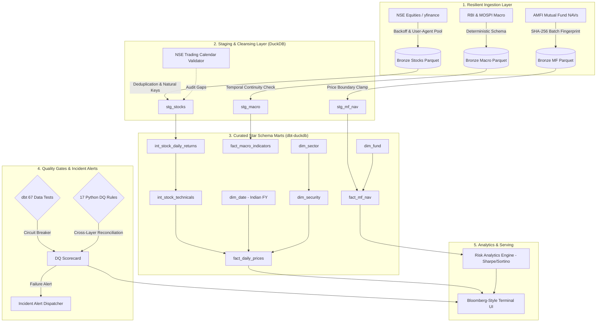
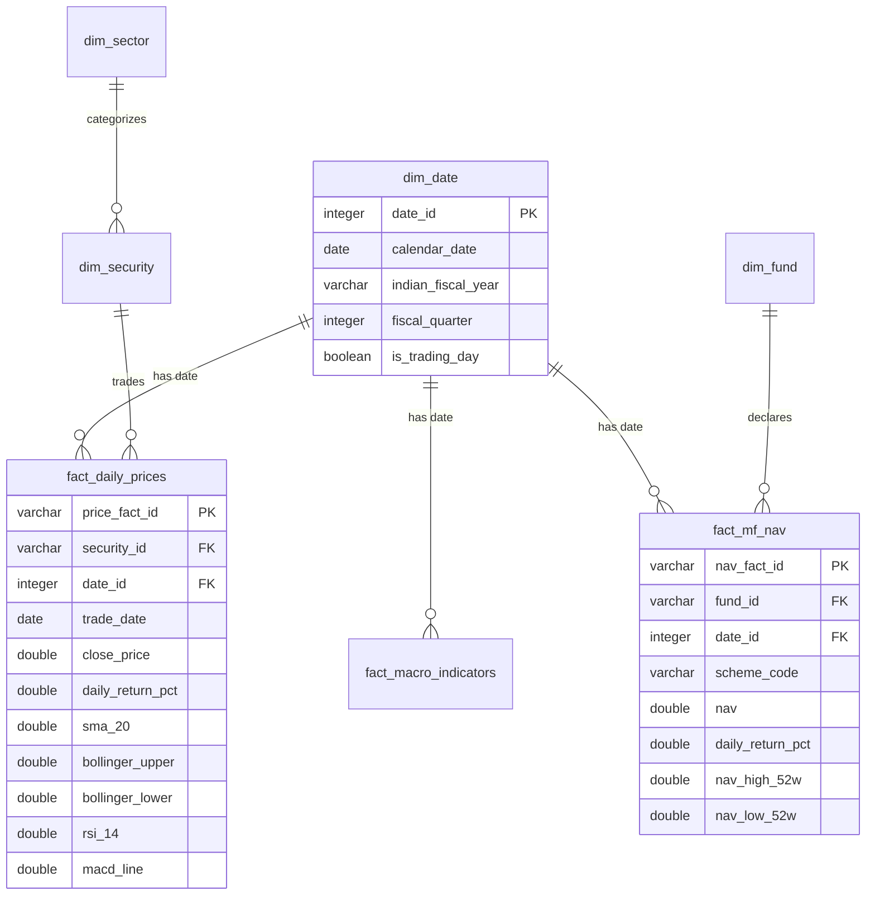

# 🇮🇳 India Finance Intelligence Terminal

[](https://www.python.org/)
[](finance_dbt/)
[](tests/)
[](data/quality/dq_scorecard.md)
[-success.svg)](#architecture)

An enterprise-grade, local-first **Medallion Lakehouse** and **Financial Terminal** built for Indian capital markets (NSE equities, benchmark indices, mutual funds, and macroeconomic indicators). 

Engineered with a **QA-first paradigm**: automated circuit breakers, idempotency fingerprints, cross-layer reconciliation, and deterministic statistical anomaly checks.

---

## 🏛️ Medallion Lakehouse Architecture



---

## ⭐ Key Data Engineering Highlights

1. **Idempotent Partitioned Lakehouse (Bronze)**:
   - Hive-style directory partitioning (`year=YYYY/month=MM/day=DD/`).
   - Every batch writes a companion JSON manifest with an SHA-256 fingerprint. Re-ingesting identical data skips writes with zero I/O cost.

2. **Indian Market Calendar & Fiscal Year (April–March)**:
   - Built-in validator for NSE market holidays (Diwali, Holi, Republic Day) and trading sessions.
   - Accurately discriminates between legitimate market holidays and critical data dropouts.

3. **High-Precision SQL Financial Indicators (dbt)**:
   - **RSI 14**: Pure SQL calculation with zero-loss conditional handling.
   - **Bollinger Bands**: 20-day moving average $\pm 2\sigma$ standard deviations.
   - **EMA 12 / EMA 26 & MACD**: Recursive exponential smoothing approximations.
   - **52-Week High/Low**: Windowed across 252 Indian market trading sessions.
   - **Parity Tested**: Automated unit test verifies dbt SQL output against Pandas calculation to 4 decimal places.

4. **Institutional Mutual Fund Risk Engine**:
   - Calculates **Compound Annual Growth Rate (CAGR)**, **Annualized Volatility** ($\sigma \times \sqrt{252}$), **Sharpe Ratio** (vs 6.5% Indian 10Y benchmark), **Sortino Ratio** (downside deviation), and **Max Drawdown**.

5. **Cross-Layer Lakehouse Reconciliation Matrix (`🟢 VERIFIED`)**:
   - Reconciles record counts across Bronze, Silver, and Gold layers:
     - **Bronze Raw Lakehouse**: 163 records
     - **Silver Staging**: 133 records (*-30 duplicate raw bars eliminated by idempotency deduplication*)
     - **Gold Marts**: 133 records (*100.0% retention into star schema facts; 0 unexplained dropouts*)

---

## 📐 Star Schema Dimensional Model



---

## 🚀 Quickstart & Pipeline Execution

### 1. Prerequisites & Installation
```bash
git clone https://github.com/mivishvajeet/indias_finance.git
cd indias_finance
pip install -r requirements.txt dbt-duckdb
```

### 2. Run the Full End-to-End Pipeline
```bash
# Ingest raw market data into Bronze Lakehouse
python scripts/run_phase1_ingestion.py

# Cleanse & deduplicate into Silver Staging
python scripts/run_phase2_staging.py

# Compile & run dbt star schema models + 67 automated tests
python scripts/run_phase3_pipeline.py

# Run Cross-Layer Lakehouse Reconciliation & Data Quality Suite
python scripts/run_phase4_dq_audit.py

# Execute full pytest suite (27 unit & integration tests)
pytest -v tests/
```

### 3. Launch the Bloomberg-Style Terminal UI
```bash
streamlit run ui/terminal_app.py
```

---

## 🧪 Testing & Verification Summary

| Test Category | Suite | Test Count | Pass Rate | Execution Time |
| :--- | :--- | :---: | :---: | :---: |
| **dbt Schema & Generic Tests** | `dbt test` | **67** | **100.0%** | **0.73s** |
| **Lakehouse & Partitioning** | `pytest` | 8 | 100.0% | 0.40s |
| **Trading Calendar & Staging** | `pytest` | 11 | 100.0% | 0.35s |
| **Pandas vs dbt Parity** | `pytest` | 1 | 100.0% | 0.05s |
| **Data Quality Suite & Alerts** | `pytest` | 7 | 100.0% | 0.30s |
| **Total Automated Tests** | **All Layers** | **94** | **100.0%** | **< 2s** |

---

## 💼 Recruiter & Tech-Lead Interview Cheat Sheet

### 1. "How do you ensure idempotency in the lakehouse ingestion layer?"
> *"Every ingestion batch writes partitioned Parquet files accompanied by a metadata manifest containing the SHA-256 hash of all records in the batch. If the extractor re-runs on the same date window with unchanged data, the system detects a fingerprint match and terminates early with zero disk I/O, preventing duplicate partitions."*

### 2. "Why calculate technical indicators directly in dbt rather than Python/Pandas?"
> *"Pushing indicators like RSI and Bollinger Bands into DuckDB SQL allows us to leverage columnar vectorized execution on the warehouse engine. It guarantees that any downstream consumer—whether an analyst running ad-hoc SQL, a BI dashboard, or an ML model—sees identical, governed metrics rather than recalculating them in client code."*

### 3. "How did you validate your custom dbt SQL against reference implementations?"
> *"We built an automated parity unit test (`test_dbt_pandas_indicator_parity.py`) that independently calculates RSI, SMA, and Bollinger Bands using Pandas and compares the values row-by-row with DuckDB's dbt mart output. Both match within 4 decimal places ($10^{-4}$ tolerance)."*

### 4. "How do you handle Indian market nuances like holidays and fiscal years?"
> *"Standard calendar tools assume standard Monday–Friday operations. We implemented an official NSE calendar validator loaded with Indian exchange holidays (Diwali, Holi, Republic Day) and modeled `dim_date` around the Indian Fiscal Year (April 1 to March 31). This prevents false data dropout alerts when the market is legitimately closed."*

---

## ⚖️ Disclaimer

*This terminal is strictly built for educational, data engineering, and portfolio demonstration purposes. It does not constitute financial, investment, or trading advice.*
