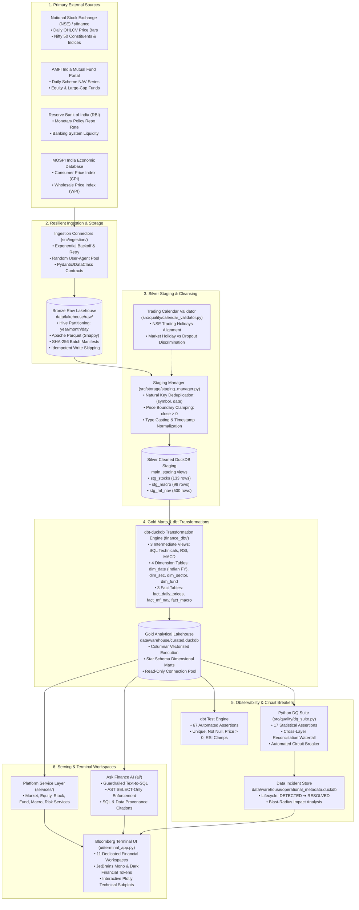
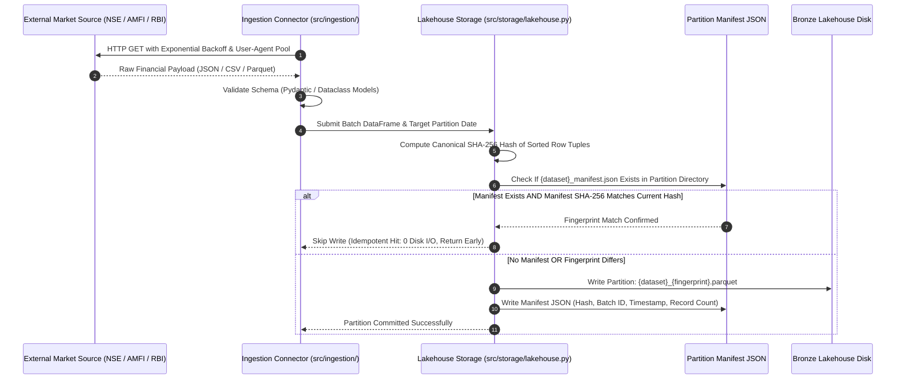
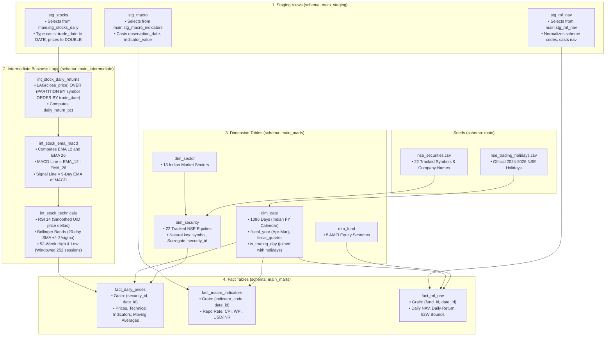
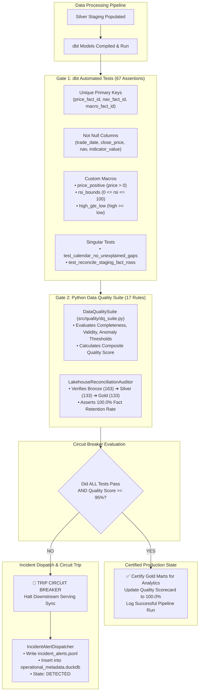
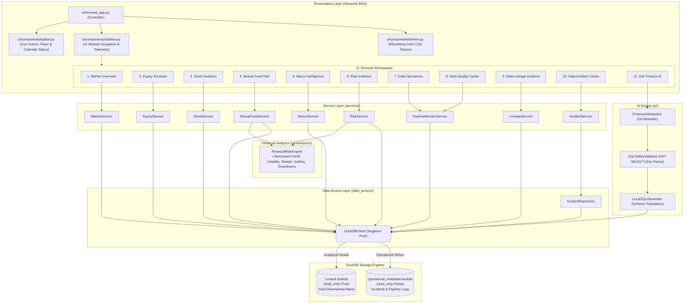
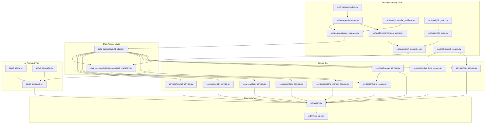
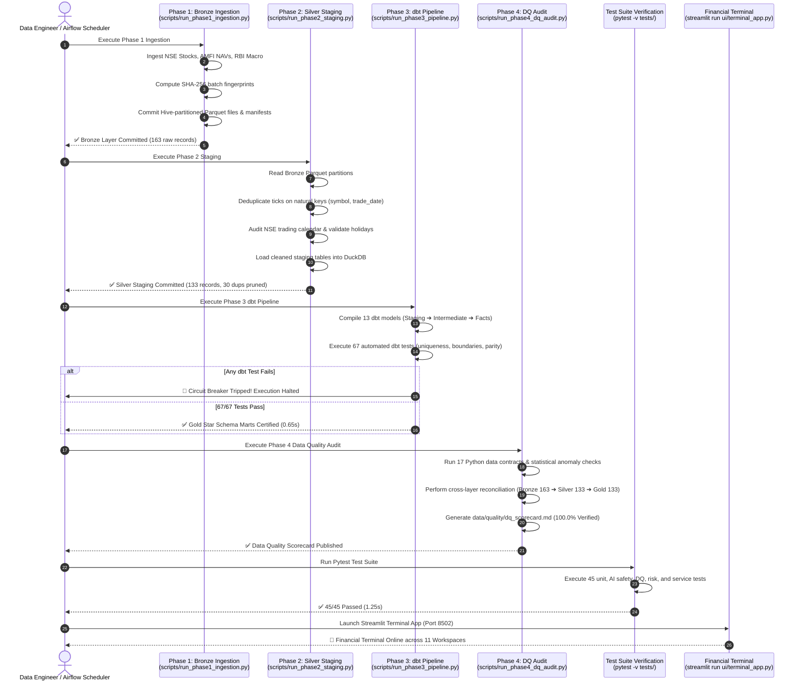
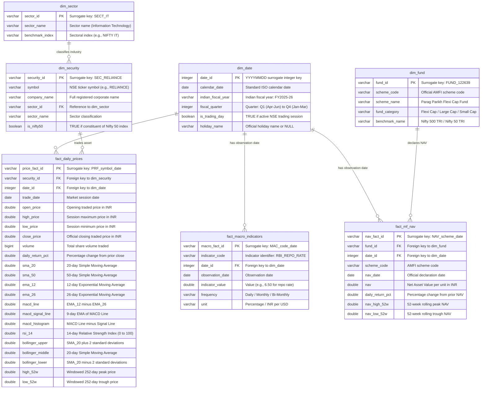

# 🏛️ India Finance Intelligence Terminal — Complete System Architecture & Engineering Blueprints

> **System**: India Finance Intelligence Terminal  
> **Document Purpose**: Authoritative system architecture, data flow diagrams, dimensional data models, and component dependency graphs.  
> **Audience**: Data Architects, Principal Data Engineers, Technical Interviewers, and Analytics Leaders.  

---

## 📑 Table of Architectural Blueprints

1. [Blueprint A: End-to-End System Architecture](#1-blueprint-a-end-to-end-system-architecture)
2. [Blueprint B: Medallion Lakehouse Architecture](#2-blueprint-b-medallion-lakehouse-architecture)
3. [Blueprint C: Resilient Ingestion & Idempotency Architecture](#3-blueprint-c-resilient-ingestion--idempotency-architecture)
4. [Blueprint D: dbt Transformation Directed Acyclic Graph (DAG)](#4-blueprint-d-dbt-transformation-directed-acyclic-graph-dag)
5. [Blueprint E: Data Quality Gates & Circuit Breaker Architecture](#5-blueprint-e-data-quality-gates--circuit-breaker-architecture)
6. [Blueprint F: Financial Terminal Serving & Analytical Architecture](#6-blueprint-f-financial-terminal-serving--analytical-architecture)
7. [Blueprint G: Repository Code & Module Dependency Graph](#7-blueprint-g-repository-code--module-dependency-graph)
8. [Blueprint H: Chronological Pipeline Execution Sequence](#8-blueprint-h-chronological-pipeline-execution-sequence)
9. [Blueprint I: Star Schema Dimensional Entity-Relationship Model (ERD)](#9-blueprint-i-star-schema-dimensional-entity-relationship-model-erd)

---

## 1. Blueprint A: End-to-End System Architecture

This blueprint illustrates the entire journey of financial data from primary Indian market sources to institutional research dashboards and local AI:

---

## 2. Blueprint B: Medallion Lakehouse Architecture

The platform strictly adheres to the Medallion Lakehouse pattern (Databricks standard adapted for local-first DuckDB columnar execution):

```mermaid
flowchart LR
    subgraph Bronze ["BRONZE (Raw Immutability)"]
        direction TB
        B1["Format: Apache Parquet (Snappy)"]
        B2["Structure: Hive Partitioning<br/>year=YYYY/month=MM/day=DD/"]
        B3["Audit: SHA-256 Batch Manifests"]
        B4["State: Raw external extracts<br/>including duplicates and retries"]
    end

    subgraph Silver ["SILVER (Cleaned & Conformed)"]
        direction TB
        S1["Engine: DuckDB In-Process Engine"]
        S2["Deduplication: Natural Key Hash<br/>(symbol, trade_date)"]
        S3["Calendar: NSE Official Holiday Validation"]
        S4["Sanitization: Positive Bounds<br/>close > 0, nav > 0, high >= low"]
    end

    subgraph Gold ["GOLD (Curated Star Schema Marts)"]
        direction TB
        G1["Modeling: Kimball Star Schema"]
        G2["Calendar: Indian Fiscal Year (April-March)"]
        G3["Technicals: RSI 14, Bollinger, MACD in SQL"]
        G4["Risk Engine: CAGR, Sharpe, Sortino, Drawdown"]
    end

    Bronze -->|"Incremental Deduplication & Cleanse"| Silver
    Silver -->|"dbt-duckdb SQL Transformations"| Gold
```

---

## 3. Blueprint C: Resilient Ingestion & Idempotency Architecture

This diagram details the SHA-256 fingerprinting and idempotency mechanism guaranteeing that re-ingestion never creates duplicate files or duplicate rows:

---

## 4. Blueprint D: dbt Transformation Directed Acyclic Graph (DAG)

The dbt project (`finance_dbt/`) orchestrates 13 modular SQL transformations with explicit lineage:

---

## 5. Blueprint E: Data Quality Gates & Circuit Breaker Architecture

This diagram illustrates how data quality is verified across multiple validation lines before analytics certification:

---

## 6. Blueprint F: Financial Terminal Serving & Analytical Architecture

This blueprint shows how the presentation layer decouples UI rendering from database execution:

---

## 7. Blueprint G: Repository Code & Module Dependency Graph

---

## 8. Blueprint H: Chronological Pipeline Execution Sequence

This sequence diagram depicts the chronological step-by-step execution flow of the daily batch data engineering cycle:

---

## 9. Blueprint I: Star Schema Dimensional Entity-Relationship Model (ERD)

The Gold layer models financial assets according to Ralph Kimball's dimensional modeling principles:

